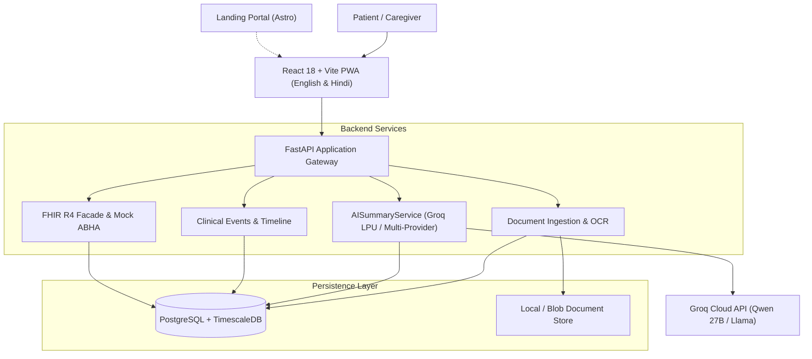

<div align="center">

# MediBot
### AI-Powered Personal Health Copilot

[](https://fastapi.tiangolo.com/)
[](https://react.dev/)
[](https://groq.com/)
[](https://hl7.org/fhir/R4/)
[](https://www.postgresql.org/)
[](https://www.docker.com/)

<p align="center">
  <strong>Transforming complex, unstructured medical documents into verified clinical facts, grounded bilingual summaries, and standard FHIR records.</strong>
</p>

</div>

---

## Overview

**MediBot** is an intelligent personal health copilot built for patients and caregivers. When users upload medical lab reports, discharge summaries, or prescriptions, MediBot ingests the documents, extracts clinical observations with provenance, generates grounded summaries in **English and Hindi**, tracks trends on an interactive health timeline, and enables healthcare interoperability via **HL7 FHIR R4** and **simulated ABHA** workflows.

---

## Key Features

1. **Document Intelligence & OCR Extraction**
   - Ingestion of PDF, PNG, and JPG medical reports.
   - Text extraction with OCR fallback and bounding snippet preservation.
   - Clinical fact normalization: test name, numeric value, unit, reference range, and collection date.
   - Confidence scoring and `needs_review` flags for low-confidence or ambiguous values.

2. **Grounded Bilingual AI Summaries (Groq LPU)**
   - Plain-language patient summaries in **English and Hindi** powered by Groq LPU inference (~0.6s latency).
   - Strict medical safety guards: strictly grounds all claims in source facts without hallucinating unstated ranges or diagnoses.
   - Automatic cache invalidation when underlying facts are updated or corrected.
   - Built-in deterministic fallback engine if offline or during provider outages.

3. **Interactive Patient Timeline & Fact Review**
   - Interactive review page to inspect source snippets, edit values, and confirm extraction.
   - Unified chronological timeline with filters by document type and date.
   - Biomarker trending with unit compatibility validation.

4. **Interoperability & Standards**
   - **HL7 FHIR R4 JSON Export**: Valid FHIR Bundle export containing `Patient`, `DocumentReference`, and `Observation` resources.
   - **Simulated ABHA Import**: Preview and confirmation workflow for simulated ABDM record imports with full idempotent deduplication.

---

## Architecture



---

## Team & Modular Architecture

| Component | Responsibility | Tech Stack |
| :--- | :--- | :--- |
| **Document OCR & Ingestion** | PDF text extraction, OCR fallback, structured JSON | Python, Tesseract / PDF2Image |
| **AI Summaries & Hindi** | Bilingual grounded summaries, prompt safety, provider adapter | Groq LPU, FastAPI, Pydantic |
| **Frontend & Bilingual UX** | Fact review, source evidence, bilingual language toggle | React 18, Vite, TailwindCSS |
| **Backend, Data & Interop** | Persistence, patient timeline, FHIR R4 export, mock ABHA | SQLAlchemy, Alembic, FHIR R4 |
| **DevOps & QA** | Reproducible configuration, Docker Compose, automated tests | Docker, Pytest, Bash |

---

## Quick Start

### 1. Prerequisites
- Python 3.12+
- Node.js 20+
- PostgreSQL (or Docker Compose)

### 2. Environment Setup
Create a `.env` file in the root directory (or use `secrets/secrets.json`):

```bash
# Server & Database
HA_APP_ENV="development"
POSTGRES_USER="postgres"
POSTGRES_PASSWORD="your_password"
POSTGRES_HOST="localhost"
POSTGRES_PORT=5432
POSTGRES_DB="medibot"

# AI Provider Configuration (Groq recommended)
GROQ_API_KEY="gsk_your_key_here"
LLM_MODEL="qwen/qwen3.8-27b"
```

### 3. Backend Setup
```bash
cd backend
python -m venv venv
# On Windows:
.\venv\Scripts\activate
# On Linux/macOS:
source venv/bin/activate

pip install -r requirements.txt
alembic upgrade head
uvicorn app.main:app --host 0.0.0.0 --port 8000 --reload
```

### 4. Frontend Setup
```bash
cd frontend
npm install
npm run dev
```
The application will be live at `http://localhost:5173`.

### 5. Running with Docker Compose
```bash
docker compose -f docker/docker-compose.yml up -d
```

---

## Live Demo Golden Path

1. **Upload**: Drop a synthetic lab report (PDF/image) into the upload dropzone.
2. **Review**: Inspect extracted observations, confidence badges, and highlighted source text snippets.
3. **Bilingual AI Summary**: Click **Generate Summary** to inspect the grounded findings in English or toggle to Hindi.
4. **Timeline**: Navigate to the patient timeline to visualize the chronological observation history.
5. **FHIR Export**: Click **Export FHIR Bundle** to download standard HL7 FHIR JSON.
6. **Mock ABHA**: Open the simulated ABHA workflow to preview and import records with audit deduplication.

---

## Medical Disclaimer

MediBot is developed for hackathon demonstration, research, and informational wellness purposes. It is **not** a licensed medical diagnostic device. It does not provide medical diagnoses or prescribe treatment plans. All extracted records and AI summaries must be verified with a certified healthcare provider.

---

## Team & Credits

Developed with by **Anshuman, Tanish & Team**.
